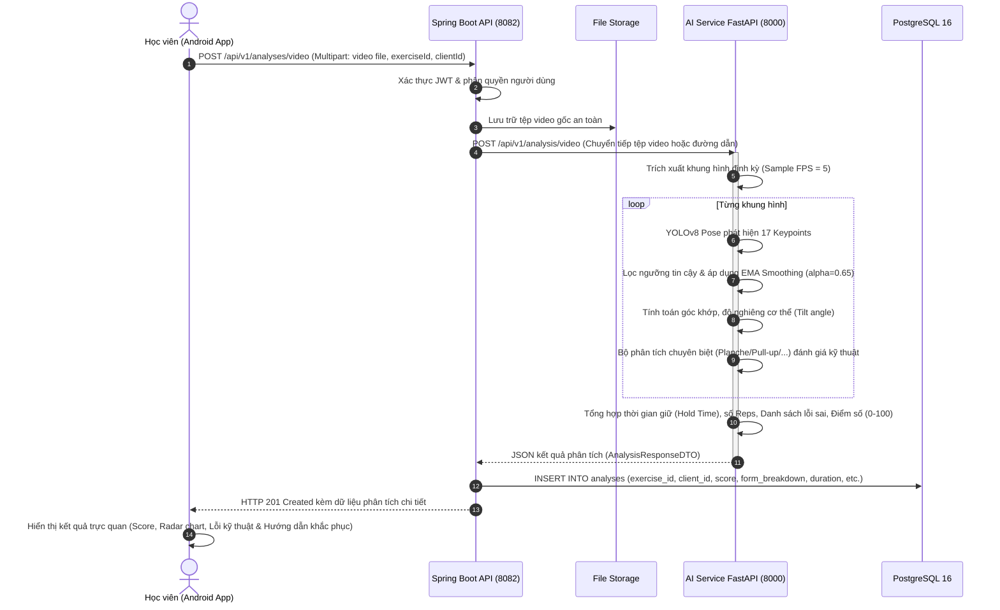
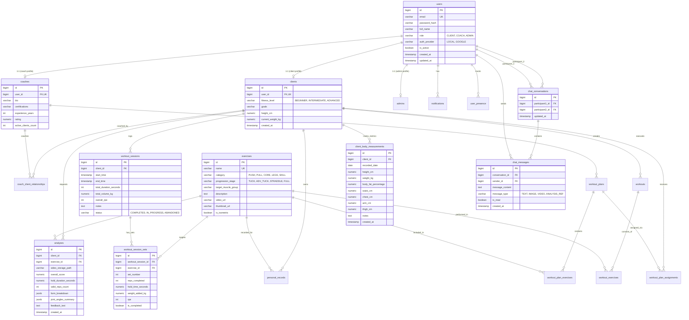
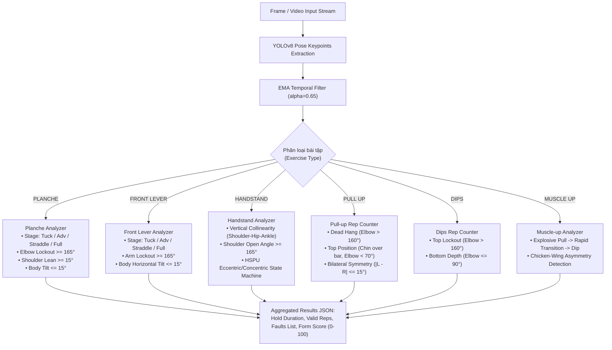
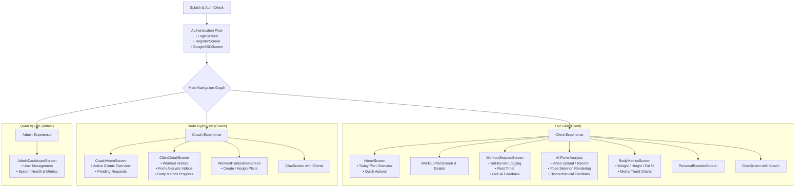

# BÁO CÁO PHÂN TÍCH TOÀN DIỆN DỰ ÁN HỆ THỐNG CALISTHENICS AI
## Comprehensive Technical Analysis & Architectural Specification

> **Phiên bản tài liệu:** 1.0.0  
> **Ngày hoàn thành:** 04/11/2026  
> **Phạm vi kiểm tra:** Toàn bộ mã nguồn 3 thành phần (`calisthenics-ai-backend`, `calisthenics-ai-service`, `calisthenics-ai-android`), cơ sở dữ liệu PostgreSQL (Migrations V1–V22), hạ tầng triển khai Docker & Cloudflare Tunnel.

---

## MỤC LỤC
1. [TỔNG QUAN HỆ THỐNG VÀ BỐI CẢNH ĐỀ TÀI](#1-tổng-quan-hệ-thống-và-bối-cảnh-đề-tài)
2. [PHÂN TÍCH YÊU CẦU NGHIỆP VỤ (REQUIREMENTS ANALYSIS)](#2-phân-tích-yêu-cầu-nghiệp-vụ-requirements-analysis)
3. [KIẾN TRÚC TỔNG THỂ VÀ MÔ HÌNH TRIỂN KHAI](#3-kiến-trúc-tổng-thể-và-mô-hình-triển-khai)
4. [THIẾT KẾ CƠ SỞ DỮ LIỆU QUAN HỆ (DATABASE DESIGN & MIGRATIONS V1–V22)](#4-thiết-kế-cơ-sở-dữ-liệu-quan-hệ-database-design--migrations-v1v22)
5. [CHI TIẾT KIẾN TRÚC BACKEND (SPRING BOOT 3) & DANH MỤC API](#5-chi-tiết-kiến-trúc-backend-spring-boot-3--danh-mục-api)
6. [ĐỘNG CƠ TRÍ TUỆ NHÂN TẠO & PHÂN TÍCH CƠ SINH HỌC (AI SERVICE DEEP DIVE)](#6-động-cơ-trí-tuệ-nhân-tạo--phân-tích-cơ-sinh-học-ai-service-deep-dive)
7. [KIẾN TRÚC ỨNG DỤNG ANDROID (JETPACK COMPOSE & MVVM)](#7-kiến-trúc-ứng-dụng-android-jetpack-compose--mvvm)
8. [KẾT QUẢ THỬ NGHIỆM VÀ ĐẢM BẢO CHẤT LƯỢNG (TESTING & QUALITY ASSURANCE)](#8-kết-quả-thử-nghiệm-và-đảm-bảo-chất-lượng-testing--quality-assurance)
9. [BẢNG ĐỐI SOÁT TRẠNG THÁI HIỆN THỰC (IMPLEMENTATION MATRIX)](#9-bảng-đối-soát-trạng-thái-hiện-thực-implementation-matrix)
10. [GIỚI HẠN KỸ THUẬT VÀ ĐỊNH HƯỚNG PHÁT TRIỂN](#10-giới-hạn-kỹ-thuật-và-định-hướng-phát-triển)

---

## 1. TỔNG QUAN HỆ THỐNG VÀ BỐI CẢNH ĐỀ TÀI

### 1.1. Đặt vấn đề
Calisthenics (Street Workout) là bộ môn rèn luyện thể chất sử dụng trọng lượng cơ thể với các động tác tĩnh (Isometric holds: Planche, Front Lever, Handstand) và động tác động (Dynamic repetitions: Pull-up, Dip, Muscle-up). Điểm đặc thù của Calisthenics là yêu cầu kiểm soát cơ sinh học (biomechanics) cực kỳ khắt khe: góc khóa khớp khuỷu (elbow lockout), độ nghiêng cơ thể (lean angle), độ thẳng hàng của cột sống - hông - cổ chân (body alignment), và độ nâng của xương bả vai (scapular protraction/retraction). 

Tập sai kỹ thuật trong Calisthenics dẫn đến:
1. **Chấn thương nghiêm trọng**: Viêm gân nhị đầu (biceps tendinitis), hội chứng chèn ép khớp vai (shoulder impingement), quá tải cột sống thắt lưng.
2. **Hiệu suất tiến bộ chậm hoặc tắc nghẽn (plateau)**: Không kích hoạt đúng nhóm cơ chủ vận do gian lận tư thế (compensation movements).
3. **Chi phí tiếp cận huấn luyện viên cá nhân (PT/Coach) cao**: Không phải học viên nào cũng có điều kiện thuê HLV theo dõi trực tiếp từng buổi tập.
4. **HLV khó quản lý học viên từ xa**: Thiếu công cụ định lượng khách quan để đánh giá form tập, đo lường thời gian giữ tư thế chuẩn (hold time) hoặc số rep hợp lệ qua video.

### 1.2. Mục tiêu của dự án Calisthenics AI
Xây dựng một hệ sinh thái phần mềm toàn diện hỗ trợ người tập Calisthenics tự luyện tập thông minh và hỗ trợ Huấn luyện viên quản lý, huấn luyện học viên từ xa:
- **Phân tích cơ sinh học thời gian thực và qua video**: Ứng dụng mô hình Pose Estimation (YOLOv8 Pose) kết hợp các giải thuật hình học động lực học để chấm điểm kỹ thuật, phát hiện lỗi sai, đếm số lần lặp (reps) và đo thời gian giữ (isometric hold duration).
- **Quản lý lộ trình tập luyện cá nhân hóa (Workout Plan & Session Tracking)**: Cho phép HLV xây dựng giáo án, gán cho học viên; học viên ghi nhận kết quả tập từng set, đo lường Volume, RPE, tải trọng và thời gian nghỉ.
- **Tương tác HLV - Học viên (Coach - Client Ecosystem)**: Cung cấp tính năng gán HLV, chat thời gian thực qua giao thức STOMP WebSocket, phản hồi video tập luyện, theo dõi chỉ số cơ thể (Body Measurements: Cân nặng, Chiều cao, Tỷ lệ mỡ, Chu vi các vòng) và bảng phân tích tiến độ (Analytics Dashboard).
- **Hệ thống phân quyền 3 vai trò (Role-Based Access Control - RBAC)**: Quản trị viên (ADMIN), Huấn luyện viên (COACH), và Học viên (CLIENT).

---

## 2. PHÂN TÍCH YÊU CẦU NGHIỆP VỤ (REQUIREMENTS ANALYSIS)

### 2.1. Phân loại tác nhân (Actors)
1. **Khách hàng / Học viên (CLIENT)**:
   - Đăng ký/đăng nhập (Email/Password hoặc Google OAuth2 SSO).
   - Thiết lập thông tin cá nhân (Profile, mục tiêu tập luyện, kinh nghiệm).
   - Xem thư viện bài tập Calisthenics có phân cấp độ (Progression levels).
   - Tiếp nhận giáo án do Coach gán hoặc tự tạo lịch tập hàng ngày.
   - Tập luyện với tính năng phân tích tư thế AI (tải video lên hoặc quay trực tiếp).
   - Ghi nhận chi tiết buổi tập: số hiệp (sets), số lần lặp (reps), tải trọng phụ trợ (weight), RPE, thời gian nghỉ (rest timer).
   - Theo dõi kỷ lục cá nhân (Personal Records - PR) và biểu đồ thể tích tập luyện (Training Volume).
   - Ghi nhận và theo dõi các chỉ số biến thiên cơ thể (Body Measurements).
   - Nhắn tin trực tiếp thời gian thực với Huấn luyện viên được chỉ định.
2. **Huấn luyện viên (COACH)**:
   - Quản lý danh sách học viên liên kết (Active Clients).
   - Thiết kế thư viện giáo án mẫu (Workout Plan Templates) và giáo án chi tiết cho từng bài tập.
   - Gán giáo án cho học viên với lịch biểu linh hoạt.
   - Xem lịch sử tập luyện, nhật ký buổi tập, kết quả phân tích AI của học viên.
   - Đánh giá, để lại nhận xét chuyên môn (Coach Feedback) cho từng buổi tập.
   - Theo dõi biểu đồ tiến độ, kỷ lục cá nhân, và các chỉ số hình thể của học viên.
   - Nhắn tin tư vấn trực tiếp với học viên qua hệ thống chat tích hợp.
3. **Quản trị viên hệ thống (ADMIN)**:
   - Giám sát toàn bộ người dùng trong hệ thống (khóa tài khoản, cấp quyền, duyệt Coach).
   - Quản lý danh mục bài tập chuẩn quốc tế (Master Exercise Library: hình ảnh mô phỏng, video hướng dẫn, cơ bắp tác động).
   - Giám sát các chỉ số vận hành hệ thống (System Metrics, Active Sessions, Storage usage, AI processing queues) thông qua Spring Boot Actuator và Admin Dashboard.

### 2.2. Ma trận yêu cầu phi chức năng (Non-Functional Requirements)
- **Độ trễ xử lý AI (Latency)**: Phân tích khung hình đơn (single frame) qua REST API đạt $\le 150$ms trên CPU/GPU phổ thông; phân tích luồng WebSocket trực tiếp đạt từ 15 đến 30 FPS.
- **Tính bảo mật (Security)**:
  - Mã hóa mật khẩu bằng thuật toán chuẩn BCrypt ($strength = 10$).
  - Xác thực không lưu phiên (Stateless Authentication) sử dụng JSON Web Token (JWT) với HMAC-SHA256, hạn sử dụng token ngắn (15-60 phút) kèm cơ chế Refresh Token an toàn.
  - Tích hợp Google OAuth2 Token Verification tại tầng Resource Server.
  - Phân quyền mức phương thức (Method-level Security) với `@PreAuthorize("hasRole('ROLE_...')")`.
- **Tính toàn vẹn dữ liệu (Data Integrity)**: Sử dụng PostgreSQL với Flyway Migration quản lý phiên bản lược đồ từ V1 đến V22, ràng buộc khóa ngoại (Foreign Keys) nghiêm ngặt, chỉ số (Indexes) trên các trường truy vấn thường xuyên.
- **Khả năng mở rộng (Scalability)**: Tách biệt hoàn toàn dịch vụ phân tích AI (Python microservice) khỏi Backend nghiệp vụ (Spring Boot) giúp scale độc lập tùy thuộc vào tải GPU/CPU.

---

## 3. KIẾN TRÚC TỔNG THỂ VÀ MÔ HÌNH TRIỂN KHAI

### 3.1. Sơ đồ kiến trúc phân tầng (High-Level Architecture)

```mermaid
flowchart TB
    subgraph ClientLayer ["1. CLIENT TIER (Mobile App)"]
        AndroidApp["Android App (Kotlin, Jetpack Compose)<br/>• Material 3 UI & Navigation Compose<br/>• Hilt Dependency Injection<br/>• Retrofit REST & OkHttp STOMP Client<br/>• CameraX Video/Frame Capture"]
    end

    subgraph GatewayLayer ["2. NETWORK & SECURITY INGRESS"]
        CF["Cloudflare Edge Network / Cloudflare Tunnel<br/>api.sky-enterprise.id.vn"]
    end

    subgraph BackendTier ["3. APPLICATION BACKEND (Spring Boot 3.2.12 - Java 21)"]
        SecurityFilter["Spring Security Filter Chain<br/>(JWT & Google OAuth2 Validator)"]
        
        subgraph Controllers ["API & Messaging Layer"]
            REST["26 Spring REST Controllers<br/>(/api/v1/*)"]
            STOMP["STOMP WebSocket Controller<br/>(/ws, /topic/*, /app/*)"]
            Actuator["Spring Boot Actuator<br/>(/actuator/health)"]
        end
        
        subgraph Services ["Business Service Layer"]
            WorkoutService["Workout & Plan Management"]
            AnalysisService["Analysis Orchestrator & RestClient"]
            ChatService["Chat & Presence Engine"]
            MetricsService["Body Metrics & Analytics"]
        end
        
        subgraph DataAccess ["Data Persistence Layer"]
            SpringDataJPA["Spring Data JPA / Hibernate 6.4"]
            Flyway["Flyway Migration Engine (V1 - V22)"]
        end
    end

    subgraph AIServiceTier ["4. AI & BIOMECHANICS MICROSERVICE (Python 3.11 - FastAPI)"]
        FastAPIApp["FastAPI REST & WebSocket Gateway"]
        YOLOv8["Ultralytics YOLOv8n-Pose Engine<br/>(17 COCO Keypoints)"]
        GeometryEngine["Biomechanical Geometry Module<br/>• 2D Angle & Tilt Calculation<br/>• EMA Temporal Smoothing (&alpha;=0.65)<br/>• Keypoint Confidence Filter (c &ge; 0.5)"]
        
        subgraph Analyzers ["Exercise-Specific Analyzers"]
            PlancheAnalyzer["Planche (Tuck -> Full, Lean, Lockout)"]
            FrontLeverAnalyzer["Front Lever (Tilt, Scapula, Arm Lockout)"]
            HandstandAnalyzer["Handstand & HSPU Rep Counter"]
            PullUpAnalyzer["Pull-up (Chin-over-bar, Lockout, Symmetry)"]
            DipAnalyzer["Dips (Depth, Lockout, Rep Counter)"]
            MuscleUpAnalyzer["Muscle-up (Transition, Chicken-wing Check)"]
        end
    end

    subgraph DatabaseTier ["5. STORAGE & DATABASE TIER"]
        Postgres["PostgreSQL 16 Alpine<br/>(Port 5432)"]
        FileSystem["File Storage System<br/>(Uploads: Videos, Avatars)"]
    end

    AndroidApp <-->|HTTPS REST & WSS STOMP| CF
    CF <-->|Localhost Tunnel (8082)| SecurityFilter
    SecurityFilter --> REST
    SecurityFilter --> STOMP
    REST --> Services
    STOMP --> ChatService
    Services --> SpringDataJPA
    SpringDataJPA --> Postgres
    Flyway --> Postgres
    AnalysisService <-->|Internal HTTP (Port 8000)| FastAPIApp
    FastAPIApp --> YOLOv8
    YOLOv8 --> GeometryEngine
    GeometryEngine --> Analyzers
    Services --> FileSystem
```

### 3.2. Luồng xử lý phân tích bài tập qua Video (Video Analysis Flow)



---

## 4. THIẾT KẾ CƠ SỞ DỮ LIỆU QUAN HỆ (DATABASE DESIGN & MIGRATIONS V1–V22)

### 4.1. Sơ đồ quan hệ thực thể (Entity-Relationship Diagram)



### 4.2. Tiến trình quản lý Migration Lược đồ (Flyway V1 - V22)
1. **V1__init_schema.sql**: Thiết lập cấu trúc người dùng cốt lõi (`users`), bảng bài tập ban đầu (`exercises`), bảng phân tích (`analyses`), và ràng buộc quan hệ cơ bản.
2. **V2__seed_exercises.sql**: Dữ liệu hạt giống (seed data) cho các bài tập Calisthenics chuẩn hóa.
3. **V3__add_firebase_uid.sql**: Bổ sung trường định danh phục vụ liên kết danh tính người dùng.
4. **V4__create_workout_plans.sql**: Bảng giáo án tập luyện (`workout_plans`).
5. **V5__create_workout_plan_exercises.sql**: Quản lý chi tiết bài tập thuộc giáo án (`workout_plan_exercises`).
6. **V6__add_active_flag_to_exercises.sql**: Thêm cờ kích hoạt (`is_active`) phục vụ quản lý vòng đời bài tập.
7. **V7__create_coach_client_relationships.sql**: Quản lý mối quan hệ HLV - Học viên, trạng thái (`PENDING`, `ACCEPTED`, `REJECTED`, `TERMINATED`).
8. **V8__create_workout_plan_assignments.sql**: Quản lý phân bổ giáo án từ Coach sang Client kèm khoảng thời gian áp dụng (`start_date`, `end_date`).
9. **V9__create_chat_tables.sql**: Bảng hội thoại và tin nhắn thời gian thực (`chat_conversations`, `chat_messages`).
10. **V10__create_coach_and_client_profiles.sql**: Tách biệt và chuẩn hóa hồ sơ chi tiết của Client (`client_profiles`) và Coach (`coach_profiles`).
11. **V11__create_persistent_workout_sessions.sql**: Thực thể lưu vết buổi tập thực tế bền vững (`workout_sessions`, `workout_session_exercises`, `workout_session_sets`).
12. **V12__add_version_to_workout_session_exercises.sql**: Cơ chế khóa lạc quan (Optimistic Locking) với trường `version` chống xung đột dữ liệu.
13. **V13__create_user_presence.sql**: Theo dõi trạng thái Online/Offline và thời điểm Heartbeat cuối cùng của người dùng (`user_presence`).
14. **V14__create_password_reset_otps.sql**: Quản lý mã OTP và xác thực khôi phục mật khẩu tài khoản.
15. **V15__add_workout_day_names.sql**: Bổ sung tên định danh các ngày tập trong tuần cho giáo án linh hoạt.
16. **V16__add_google_id_to_users.sql**: Tích hợp trường `google_id` phục vụ đăng nhập Google OAuth2 SSO.
17. **V17__create_exercise_analytics_and_prs.sql**: Bảng phân tích khối lượng tập luyện và tự động ghi nhận kỷ lục cá nhân (`personal_records`, `coach_feedback`).
18. **V18__enhance_personal_records_manual_tracking.sql**: Hỗ trợ ghi nhận và điều chỉnh PR thủ công linh hoạt cho người tập.
19. **V19__add_client_message_id_to_chat_messages.sql**: Bổ sung UUID tin nhắn phía client (`client_message_id`) đảm bảo tính Idempotency trong STOMP WebSocket.
20. **V20__create_notifications_and_enhance_pr_shares.sql**: Hệ thống thông báo đẩy trong ứng dụng (`notifications`) và chia sẻ kỷ lục cá nhân (`shared_personal_records`).
21. **V21__create_client_body_metrics.sql**: Lưu trữ số đo cơ thể của Client với độ chính xác số học `NUMERIC(5, 1)` (Chiều cao, cân nặng, % mỡ, vòng eo, ngực, bắp tay, đùi).
22. **V22__add_media_and_equipment_to_exercises.sql**: Mở rộng danh mục bài tập với thông tin dụng cụ tập luyện (`equipment`) và liên kết phương tiện hướng dẫn kỹ thuật (`media_url`).

---

## 5. CHI TIẾT KIẾN TRÚC BACKEND (SPRING BOOT 3) & DANH MỤC API

### 5.1. Mô hình phân lớp & Công nghệ
Backend được xây dựng dựa trên **Spring Boot 3.2.12** chạy trên nền **Java 21 LTS**, tuân thủ kiến trúc phân tầng chuẩn doanh nghiệp (Enterprise Layered Architecture):
- **Web / Controller Layer**: 26 Spring RestControllers đón nhận yêu cầu HTTP RESTful và 1 WebSocket Controller quản lý giao tiếp STOMP hai chiều.
- **Security & Filter Layer**: `JwtAuthenticationFilter` phân giải Bearer token từ header, tra cứu `UserDetailsServiceImpl`, thiết lập `SecurityContext`. Đồng thời hỗ trợ `GoogleOAuth2AuthFilter` xác thực ID Token qua thư viện Google API Client.
- **Service Layer**: 35+ Interfaces và Service Implementations chứa toàn bộ logic điều phối nghiệp vụ, transaction management (`@Transactional`), và giao tiếp REST với Python AI Service thông qua Spring 6 `RestClient`.
- **Repository / DAO Layer**: Spring Data JPA kế thừa `JpaRepository` với các truy vấn tùy biến tối ưu bằng JPQL và Native SQL.
- **Global Error Handling**: `GlobalExceptionHandler` bắt các ngoại lệ nghiệp vụ (`EntityNotFoundException`, `AccessDeniedException`, `ValidationException`), định dạng phản hồi chuẩn JSON: `{ timestamp, status, error, message, path }`.

### 5.2. Danh mục 26 REST Controllers & Endpoint End-to-End

| STT | Tên Controller | Base Path | Mô tả chức năng chính | Phân quyền |
|---|---|---|---|---|
| 1 | `AuthController` | `/api/v1/auth` | Đăng ký, đăng nhập Local, đăng nhập Google SSO, làm mới Refresh Token, Đổi mật khẩu | Public / Authenticated |
| 2 | `UserController` | `/api/v1/users` | Quản lý thông tin tài khoản cơ sở, cập nhật avatar, kiểm tra trạng thái hoạt động | Authenticated |
| 3 | `ClientController` | `/api/v1/clients` | Quản lý hồ sơ học viên (Fitness level, mục tiêu, chiều cao, cân nặng ban đầu) | CLIENT, COACH, ADMIN |
| 4 | `CoachController` | `/api/v1/coaches` | Quản lý hồ sơ HLV, kinh nghiệm, chứng chỉ, hiển thị danh sách Coach công khai | Public / COACH / ADMIN |
| 5 | `CoachClientRelationshipController` | `/api/v1/relationships` | Gửi yêu cầu kết nối, chấp thuận/từ chối học viên, hủy liên kết đào tạo | CLIENT, COACH |
| 6 | `ExerciseController` | `/api/v1/exercises` | Tra cứu danh mục bài tập, phân loại theo động tác (Push/Pull) và cấp độ tiến trình | Authenticated |
| 7 | `WorkoutPlanController` | `/api/v1/workout-plans` | Khởi tạo, chỉnh sửa giáo án tập luyện mẫu (Template Plans) | COACH, ADMIN |
| 8 | `WorkoutPlanExerciseController` | `/api/v1/workout-plans/{id}/exercises` | Thêm, bớt, sắp xếp thứ tự và cấu hình sets/reps của bài tập trong giáo án | COACH, ADMIN |
| 9 | `WorkoutPlanAssignmentController` | `/api/v1/workout-plan-assignments` | Gán giáo án cho học viên cụ thể với ngày bắt đầu/kết thúc | COACH |
| 10 | `TodayWorkoutController` | `/api/v1/today-workout` | Truy vấn bài tập và lịch trình được chỉ định cho học viên trong ngày hiện tại | CLIENT |
| 11 | `WorkoutController` | `/api/v1/workouts` | Quản lý lịch tập của Client, đánh dấu hoàn thành bài tập | CLIENT, COACH |
| 12 | `PersistentWorkoutSessionController` | `/api/v1/workout-sessions` | Ghi nhận toàn bộ phiên tập trực tiếp: bắt đầu, hoàn thành hiệp (Sets), tính Volume | CLIENT |
| 13 | `PersonalRecordController` | `/api/v1/personal-records` | Tự động ghi nhận và hiển thị kỷ lục cá nhân mới (Max Reps, Max Hold Time) | CLIENT, COACH |
| 14 | `AnalysisController` | `/api/v1/analyses` | Tải video lên phân tích AI, truy vấn lịch sử phân tích, lấy kết quả chi tiết kèm góc khớp | CLIENT, COACH |
| 15 | `CoachAnalyticsController` | `/api/v1/coach/analytics` | Thống kê số lượng học viên, tỷ lệ tuân thủ giáo án, đánh giá trung bình của HLV | COACH |
| 16 | `TrainingAnalyticsController` | `/api/v1/training-analytics` | Tổng hợp khối lượng tập (Volume load), số set hoàn thành theo tuần/tháng | CLIENT, COACH |
| 17 | `UserPresenceController` | `/api/v1/presence` | Truy vấn trạng thái Online/Offline và thời điểm hoạt động gần nhất của user | Authenticated |
| 18 | `PresenceHeartbeatController` | `/api/v1/presence/heartbeat` | Gửi tín hiệu Heartbeat định kỳ duy trì trạng thái Online | Authenticated |
| 19 | `ChatController` | `/api/v1/chat` | Lấy danh sách hội thoại, lịch sử tin nhắn, đánh dấu đã đọc tin nhắn | Authenticated |
| 20 | `ChatWebSocketController` | STOMP `/app/*` | Nhận và chuyển tiếp tin nhắn thời gian thực qua kênh `/topic/conversation.{id}` | Authenticated |
| 21 | `NotificationController` | `/api/v1/notifications` | Lấy danh sách thông báo của người dùng, đánh dấu đã đọc | Authenticated |
| 22 | `StorageController` | `/api/v1/storage` | Tải lên và truy xuất tệp tĩnh (hình đại diện, video bài tập, ảnh minh họa) | Authenticated |
| 23 | `ClientBodyMetricsController` | `/api/v1/client/body-metrics` | Học viên tự ghi nhận, xem lịch sử và biểu đồ các chỉ số hình thể (Weight, Body Fat) | CLIENT |
| 24 | `CoachBodyMetricsController` | `/api/v1/coach/clients/{id}/body-metrics` | HLV theo dõi số đo và xu hướng thay đổi cơ thể của học viên được chỉ định | COACH |
| 25 | `AdminController` | `/api/v1/admin` | Thống kê toàn hệ thống, quản lý khóa/mở tài khoản người dùng, giám sát dữ liệu | ADMIN |
| 26 | `AdminBootstrapController` | `/api/v1/admin/bootstrap` | Endpoint khởi tạo tài khoản quản trị viên gốc ban đầu trong môi trường mới | Restricted |

---

## 6. ĐỘNG CƠ TRÍ TUỆ NHÂN TẠO & PHÂN TÍCH CƠ SINH HỌC (AI SERVICE DEEP DIVE)

### 6.1. Kiến trúc mô hình YOLOv8 Pose & 17 Điểm then chốt (COCO Keypoints)
Dịch vụ AI sử dụng mô hình học sâu **Ultralytics YOLOv8n-pose** được tối ưu hóa cho bài toán ước lượng tư thế người (Human Pose Estimation). Mô hình trích xuất đồng thời bounding box và tọa độ không gian 2 chiều của 17 điểm then chốt trên cơ thể người theo chuẩn tập dữ liệu COCO:

$$\mathcal{K} = \{ (x_i, y_i, c_i) \}_{i=0}^{16}$$

Trong đó:
- $(x_i, y_i)$: Tọa độ điểm khớp chuẩn hóa theo kích thước ảnh.
- $c_i \in [0, 1]$: Điểm số tin cậy (Confidence score) của điểm khớp thứ $i$.

| Chỉ số $i$ | Tên khớp (Keypoint) | Chỉ số $i$ | Tên khớp (Keypoint) |
|---|---|---|---|
| **0** | Mũi (Nose) | **9** | Cổ tay trái (Left Wrist) |
| **1, 2** | Mắt trái, Mắt phải (L/R Eye) | **10** | Cổ tay phải (Right Wrist) |
| **3, 4** | Tai trái, Tai phải (L/R Ear) | **11** | Khớp hông trái (Left Hip) |
| **5** | Khớp vai trái (Left Shoulder) | **12** | Khớp hông phải (Right Hip) |
| **6** | Khớp vai phải (Right Shoulder) | **13** | Khớp gối trái (Left Knee) |
| **7** | Khớp khuỷu trái (Left Elbow) | **14** | Khớp gối phải (Right Knee) |
| **8** | Khớp khuỷu phải (Right Elbow) | **15, 16** | Cổ chân trái/phải (L/R Ankle) |

### 6.2. Cơ sở toán học & Các giải thuật tiền xử lý cơ sinh học
Để đảm bảo tín hiệu tọa độ không bị rung lắc (jitter) giữa các frame liên tiếp do nhiễu camera, hệ thống tích hợp bộ lọc làm mượt trung bình động hàm mũ (**Exponential Moving Average - EMA**) và thuật toán lọc độ tin cậy:

#### 1. Bộ lọc làm mượt theo thời gian (Temporal EMA Smoothing)
Với mỗi điểm khớp thứ $i$ tại thời điểm $t$, tọa độ đã làm mượt $\hat{P}_t$ được tính từ tọa độ quan sát được $P_t$ và tọa độ đã mượt của frame trước $\hat{P}_{t-1}$:

$$\hat{P}_t = \alpha P_t + (1 - \alpha) \hat{P}_{t-1}, \quad \text{với hệ số } \alpha = 0.65$$

Nếu $c_i < 0.5$ (ngưỡng tin cậy tối thiểu), hệ thống bảo toàn vị trí ước tính từ frame trước $\hat{P}_t = \hat{P}_{t-1}$ nhằm tránh hiện tượng giật cục do che khuất (occlusion).

#### 2. Công thức tính góc khớp 2D (Joint Angle Formula)
Cho 3 điểm khớp liên tiếp $A(x_A, y_A)$, $B(x_B, y_B)$ (khớp đỉnh góc), và $C(x_C, y_C)$. Hai vector cấu thành là $\vec{u} = \vec{BA} = A - B$ và $\vec{v} = \vec{BC} = C - B$.  
Góc khớp $\theta \in [0^\circ, 180^\circ]$ được tính bằng tích vô hướng hoặc thông qua hàm `atan2`:

$$\theta = \left| \operatorname{atan2}(C_y - B_y, C_x - B_x) - \operatorname{atan2}(A_y - B_y, A_x - B_x) \right| \times \frac{180^\circ}{\pi}$$

Nếu $\theta > 180^\circ$, chuẩn hóa $\theta = 360^\circ - \theta$.

#### 3. Công thức tính độ nghiêng đường thẳng thân người (Body Line / Tilt Angle)
Độ nghiêng của một đoạn thẳng (ví dụ: đường thẳng nối Vai - Hông hoặc Hông - Cổ chân) so với phương ngang trục hoành $(1, 0)$ được xác định bởi:

$$\text{Tilt}_{\text{horizontal}} = \left| \operatorname{atan2}(\Delta y, \Delta x) \right| \times \frac{180^\circ}{\pi}$$

### 6.3. Chi tiết 6 Bộ phân tích bài tập chuyên biệt (Exercise Analyzers)



1. **Planche Analyzer (`planche.py`)**:
   - *Phát hiện cấp độ tiến trình*: Dựa trên khoảng cách tỷ đối giữa Đầu gối và Khớp hông, góc gập hông (Hip angle) và góc gập gối (Knee angle).
     - **Tuck Planche**: Đầu gối co sát ngực (Knee angle $< 90^\circ$, Hip angle $< 90^\circ$).
     - **Advanced Tuck Planche**: Đùi vuông góc với thân người (Hip angle $\approx 90^\circ$, Knee angle $< 100^\circ$).
     - **Straddle Planche**: Hai chân dang rộng, thân thẳng ngang.
     - **Full Planche**: Toàn bộ cơ thể thẳng hàng ngang (Hip angle $\ge 170^\circ$, Knee angle $\ge 170^\circ$).
   - *Quy tắc chấm form chuẩn*:
     - Khóa khớp khuỷu: Góc khuỷu $\ge 165^\circ$. Nếu $< 165^\circ$, cảnh báo lỗi "Bent Arm / Trùng tay".
     - Góc đổ vai về phía trước (Shoulder Lean): Tọa độ vai phải vượt trước cổ tay theo trục $x$, góc nghiêng đường vai-cổ tay so với phương đứng $\ge 15^\circ$.
     - Đường thẳng thân người so với phương ngang: Độ lệch $|\text{Tilt}| \le 15^\circ$.
2. **Front Lever Analyzer (`front_lever.py`)**:
   - *Tiến trình*: Phân cấp Tuck, Adv Tuck, Straddle, Full tương tự Planche.
   - *Quy tắc chuẩn*: Cánh tay thẳng (Elbow $\ge 165^\circ$), thân người song song mặt đất (Độ nghiêng vai - hông - cổ chân $\le 12^\circ$ so với phương ngang), góc mở nách/khớp vai $\approx 90^\circ$ so với cánh tay thẳng đứng.
3. **Handstand & HSPU Analyzer (`handstand.py`)**:
   - *Độ thẳng hàng theo phương đứng (Vertical Line)*: Góc giữa Cổ tay - Vai - Hông và Vai - Hông - Cổ chân đạt từ $165^\circ$ đến $180^\circ$. Độ lệch so với phương thẳng đứng $\le 10^\circ$.
   - *Bộ đếm rep Handstand Push-up (HSPU)*: Máy trạng thái hữu hạn (FSM) gồm 3 pha:
     - `START`: Đỉnh handstand, khuỷu tay thẳng ($> 160^\circ$).
     - `ECCENTRIC`: Hạ người xuống, khuỷu tay gập đạt độ sâu chuẩn ($\le 90^\circ$).
     - `CONCENTRIC`: Đẩy trở lại vị trí khóa khớp ($> 160^\circ$), hoàn thành 1 rep hợp lệ.
4. **Pull-up Analyzer (`pull_up.py`)**:
   - *State Machine*: `DEAD_HANG` (Khuỷu $> 160^\circ$) $\rightarrow$ `ASCENDING` $\rightarrow$ `TOP` (Cằm vượt thanh xà, cằm cao hơn vị trí cổ tay, góc khuỷu $< 70^\circ$) $\rightarrow$ `DESCENDING` $\rightarrow$ `LOCKED`.
   - *Kiểm tra tính đối xứng cơ thể (Bilateral Symmetry)*: So sánh góc khuỷu tay trái và phải $|\theta_{\text{left\_elbow}} - \theta_{\text{right\_elbow}}| \le 15^\circ$. Nếu vượt quá ngưỡng, cảnh báo lỗi mất cân bằng lực kéo.
5. **Dips Analyzer (`dips.py`)**:
   - *State Machine*: `TOP_LOCKOUT` (Khuỷu $> 160^\circ$) $\rightarrow$ `DESCENDING` $\rightarrow$ `BOTTOM_POSITION` (Góc khuỷu gập $\le 90^\circ$, vai thấp hơn khuỷu) $\rightarrow$ `ASCENDING` $\rightarrow$ `COMPLETE_REP`.
6. **Muscle-up Analyzer (`muscle_up.py`)**:
   - *Nhận diện pha chuyển tiếp (Transition Phase)*: Giai đoạn biến đổi từ lực kéo (Pull) sang lực đẩy xà (Dip).
   - *Phát hiện lỗi nguy hiểm "Chicken Wing"*: Hiện tượng một khuỷu tay leo lên trước khuỷu tay kia. Nếu độ trễ thời gian giữa 2 tay vượt quá $0.2$ giây hoặc độ lệch góc khuỷu khi qua xà $> 25^\circ$, hệ thống phát hiện lỗi "Lên xà cánh gà - Nguy cơ chấn thương khớp vai".

---

## 7. KIẾN TRÚC ỨNG DỤNG ANDROID (JETPACK COMPOSE & MVVM)

### 7.1. Mô hình kiến trúc ứng dụng
Ứng dụng di động được xây dựng hoàn toàn bằng **Kotlin** theo tiêu chuẩn thiết kế kiến trúc hiện đại của Google (Modern Android Architecture):
- **UI Toolkit**: Jetpack Compose kết hợp Material Design 3 (Dynamic Color, Typography chuẩn, Dark/Light theme).
- **Mô hình kiến trúc**: Model - View - ViewModel (MVVM) kết hợp Clean Architecture phân tách rõ rệt: Presentation Layer, Domain Layer (Use Cases/State), và Data Layer (Repositories & Data Sources).
- **Quản lý trạng thái (State Management)**: Sử dụng Kotlin Coroutines và `StateFlow` phát ra các Immutable UI State classes (ví dụ: `WorkoutSessionUiState`, `AnalysisUiState`).
- **Dependency Injection**: Google Dagger Hilt (`@HiltViewModel`, `@Inject`, `@Module`, `@InstallIn(SingletonComponent::class)`).
- **Mạng và đồng bộ**:
  - Retrofit 2 với Gson Converter.
  - OkHttp Interceptor: `AuthInterceptor` tự động đính kèm `Bearer {jwt_token}` và xử lý tự động gọi Refresh Token khi nhận mã lỗi HTTP 401.
  - STOMP Client qua OkHttp WebSocket cho tính năng Chat trực tiếp.

### 7.2. Danh mục màn hình chính & Luồng trải nghiệm người dùng (UX Flows)



---

## 8. KẾT QUẢ THỬ NGHIỆM VÀ ĐẢM BẢO CHẤT LƯỢNG (TESTING & QUALITY ASSURANCE)

Quá trình kiểm thử được thực thi tự động toàn diện trên toàn bộ 3 phân hệ của hệ thống, minh chứng cho tính ổn định và sẵn sàng vận hành thực tế:

### 8.1. Kiểm thử Backend (Spring Boot 3)
- **Công cụ**: JUnit 5, Mockito, Spring Boot Test (`@SpringBootTest`, `@WebMvcTest`, `@DataJpaTest`), Testcontainers.
- **Lệnh thực thi**: `mvn test`
- **Kết quả thực tế ghi nhận**:
  - **164 bài kiểm thử đã chạy (164 tests run)**
  - **0 lỗi thất bại (0 failures)**
  - **0 lỗi hệ thống (0 errors)**
  - **0 bài bị bỏ qua (0 skipped)**
  - **Trạng thái đóng gói**: `mvn package -DskipTests` $\rightarrow$ **BUILD SUCCESS**.
- **Phạm vi kiểm thử bao phủ**:
  - Toàn bộ 26 REST Controller với kiểm tra validation dữ liệu đầu vào (`@Valid`, constraints).
  - Tầng dịch vụ logic: tính toán Volume, tự động ghi nhận kỷ lục cá nhân (PR detection), phân quyền bảo mật JWT và Google OAuth2 token.
  - Tầng ánh xạ cơ sở dữ liệu (JPA Entities, Flyway schema validation V1–V22).

### 8.2. Kiểm thử Dịch vụ AI (Python FastAPI)
- **Công cụ**: Pytest, NumPy, Pydantic test fixtures.
- **Lệnh thực thi**: `pytest tests/ -q`
- **Kết quả thực tế ghi nhận**:
  - **104 bài kiểm thử hoàn thành thành công (104 passed in 6.70s)**
  - **0 bài kiểm thử thất bại (0 failed)**
- **Nội dung kiểm thử**:
  - Độ chính xác toán học của hàm tính góc 2D (`test_angles.py`): kiểm tra với các góc đặc biệt ($0^\circ, 45^\circ, 90^\circ, 180^\circ$).
  - Bộ lọc EMA: kiểm tra tính mượt và tính toàn vẹn khi có khung hình bị mất điểm khớp ($c_i < 0.5$).
  - Bộ phát hiện cấp độ Planche (Tuck, Adv Tuck, Straddle, Full) dựa trên ma trận tọa độ giả lập chuẩn cơ sinh học.
  - Máy trạng thái đếm rep Pull-up, HSPU, Dips và kiểm tra điều kiện phát hiện lỗi "Chicken-wing" của Muscle-up.

### 8.3. Kiểm thử Ứng dụng Di động Android
- **Công cụ**: JUnit 4/5, MockK, Kotlinx Coroutines Test.
- **Lệnh thực thi**: `./gradlew testDebugUnitTest --rerun-tasks`
- **Kết quả thực tế ghi nhận**:
  - **31 bài kiểm thử đơn vị thành công (31 tests passed in 53s)**
  - **0 bài kiểm thử thất bại (0 failed)**
  - **Trạng thái đóng gói APK**: `./gradlew assembleDebug` $\rightarrow$ **BUILD SUCCESSFUL**.
- **Nội dung kiểm thử**:
  - Các ViewModel chính: `WorkoutSessionViewModel`, `AnalysisViewModel`, `BodyMetricsViewModel`, `AuthViewModel`.
  - Luồng chuyển trạng thái giao diện UI (`StateFlow`), cơ chế tự động thử lại khi mất mạng, xử lý token hết hạn trong OkHttp Interceptor.

---

## 9. BẢNG ĐỐI SOÁT TRẠNG THÁI HIỆN THỰC (IMPLEMENTATION MATRIX)

Bảng phân loại sau phản ánh chính xác tình trạng mã nguồn thực tế trong dự án, phân định rõ ràng giữa những gì đã hiện thực hoàn chỉnh, hiện thực một phần và kế hoạch tương lai:

| Phân hệ / Tính năng | Mô tả chi tiết kỹ thuật | Trạng thái hiện thực | Vị trí minh chứng mã nguồn |
|---|---|---|---|
| **Xác thực người dùng (Auth)** | Đăng nhập Local (BCrypt, JWT), Google SSO, Refresh Token | **Đã hoàn thành 100%** | `AuthController.java`, `JwtUtils.java`, `SecurityConfig.java` |
| **Phân quyền 3 vai trò (RBAC)** | CLIENT, COACH, ADMIN với `@PreAuthorize` | **Đã hoàn thành 100%** | `SecurityConfig.java`, `UserRole.java`, Migrations V1 |
| **Danh mục bài tập chuẩn** | Phân loại động/tĩnh, cơ tác động, cấp độ tiến trình | **Đã hoàn thành 100%** | `ExerciseController.java`, `ExerciseService.java`, Migration V3 |
| **Quản lý Giáo án (Workout Plans)** | Thiết kế giáo án, gán cho Client theo lịch | **Đã hoàn thành 100%** | `WorkoutPlanController.java`, `WorkoutPlanAssignmentController.java` |
| **Ghi nhận phiên tập (Sessions & Sets)** | Ghi log từng set, RPE, tính toán khối lượng Volume tập | **Đã hoàn thành 100%** | `PersistentWorkoutSessionController.java`, `WorkoutSessionServiceImpl.java` |
| **Kỷ lục cá nhân (PR Tracking)** | Tự động cập nhật khi set tập vượt kỷ lục cũ | **Đã hoàn thành 100%** | `PersonalRecordController.java`, `PersonalRecordServiceImpl.java` |
| **Theo dõi số đo cơ thể (Body Metrics)** | Lưu trữ số đo cân nặng, chiều cao, % mỡ, vòng eo/ngực | **Đã hoàn thành 100%** | `ClientBodyMetricsController.java`, `CoachBodyMetricsController.java` |
| **Nhắn tin trực tiếp (Chat & Presence)** | Giao tiếp thời gian thực qua STOMP WebSocket & Heartbeat | **Đã hoàn thành 100%** | `ChatController.java`, `ChatWebSocketController.java`, `UserPresenceController.java` |
| **Phân tích AI qua Video (Batch)** | Tải video lên, trích xuất khung hình 5 FPS, chấm điểm form | **Đã hoàn thành 100%** | `AnalysisController.java`, `calisthenics-ai-service/app/api/routes/analysis.py` |
| **Phân tích AI theo khung hình (Frame)** | REST API nhận diện tức thời từng frame ảnh đơn | **Đã hoàn thành 100%** | `calisthenics-ai-service/app/api/routes/analysis.py` |
| **Bộ phân tích 6 bài tập Calisthenics** | Planche, Front Lever, Handstand, Pull-up, Dips, Muscle-up | **Đã hoàn thành 100%** | `calisthenics-ai-service/app/biomechanics/analyzers/*` |
| **Phân tích AI luồng trực tiếp (Live WS)** | WebSocket streaming phân tích trực tiếp theo thời gian thực | **Hiện thực một phần (Core Engine có sẵn, Android cần tối ưu FPS)** | `calisthenics-ai-service/app/api/routes/live_analysis.py` |
| **Bảng điều khiển Quản trị (Admin)** | Xem số liệu tổng quan người dùng, khóa tài khoản | **Đã hoàn thành 100%** | `AdminController.java`, `AdminServiceImpl.java` |
| **Triển khai VPS & Mạng an toàn** | Chạy Docker container, điều hướng Cloudflare Tunnel | **Đã hoàn thành 100%** | `docker-compose.yml`, `VPS_AUDIT.md`, `systemd cloudflared` |
| **Mô hình AI 3D Pose Estimation** | Nâng cấp từ 2D lên tái tạo tư thế 3D bằng camera đơn | **Định hướng tương lai (Planned)** | Chưa tích hợp (đòi hỏi mô hình 3D lifting đắt đỏ) |

---

## 10. GIỚI HẠN KỸ THUẬT VÀ ĐỊNH HƯỚNG PHÁT TRIỂN

### 10.1. Các giới hạn kỹ thuật thực tế (Honest Technical Limitations)
1. **Bản chất của ước lượng tư thế 2D (Monocular 2D Pose Estimation)**:
   - Hệ thống dựa trên YOLOv8 Pose trích xuất tọa độ 2 chiều trên mặt phẳng ảnh $(x, y)$. Khi người tập thực hiện động tác ngoài mặt phẳng vuông góc với camera (out-of-plane movements), hiện tượng co ngắn phối cảnh (foreshortening) có thể làm sai lệch góc đo thực tế.
   - Không thể đo đạc trực tiếp các thông số động lực học nội tại như: mô-men xoắn khớp (joint torques), phản lực từ thanh xà (ground reaction forces), hoặc mức độ kích hoạt điện cơ (electromyography - EMG). Mọi kết luận đều dựa trên suy diễn hình học động học thuần túy (Kinematics).
2. **Yêu cầu góc quay Camera**:
   - Đối với các bài tập giữ thăng bằng như Planche và Front Lever, camera bắt buộc phải đặt ở **góc nhìn ngang chuẩn (Sagittal / Side-view)** để hệ thống đo đạc chính xác góc nghiêng cơ thể và góc khóa khuỷu.
   - Đối với bài tập kéo như Pull-up, camera cần đặt ở **góc nhìn trực diện (Coronal / Frontal-view)** để phân tích tính đối xứng cơ thể giữa 2 cánh tay.
3. **Môi trường ánh sáng và trang phục**:
   - Quần áo quá rộng hoặc môi trường ánh sáng yếu có thể làm giảm độ tin cậy ($c_i < 0.5$) của các điểm then chốt khuỷu tay và mắt cá chân.

### 10.2. Định hướng phát triển tương lai (Future Roadmap)
- **Tích hợp mô hình 3D Pose Reconstruction**: Nghiên cứu ứng dụng các kiến trúc Transformer nâng cao (như MotionBERT hoặc MediaPipe 3D World Landmarks) để tái tạo khung xương không gian 3 chiều từ video đơn góc quay.
- **Tối ưu hóa On-device AI trên thiết bị di động**: Chuyển đổi mô hình YOLOv8 Pose sang định dạng TFLite hoặc ONNX Runtime with NNAPI/GPU delegate để chạy trực tiếp trên smartphone Android, triệt tiêu hoàn toàn độ trễ truyền tải mạng.
- **Hệ thống gợi ý bài tập thông minh (AI Workout Recommendation)**: Ứng dụng giải thuật học máy phân tích lịch sử tập luyện và tỷ lệ lỗi sai để tự động đề xuất các bài tập bổ trợ khắc phục nhóm cơ yếu.
