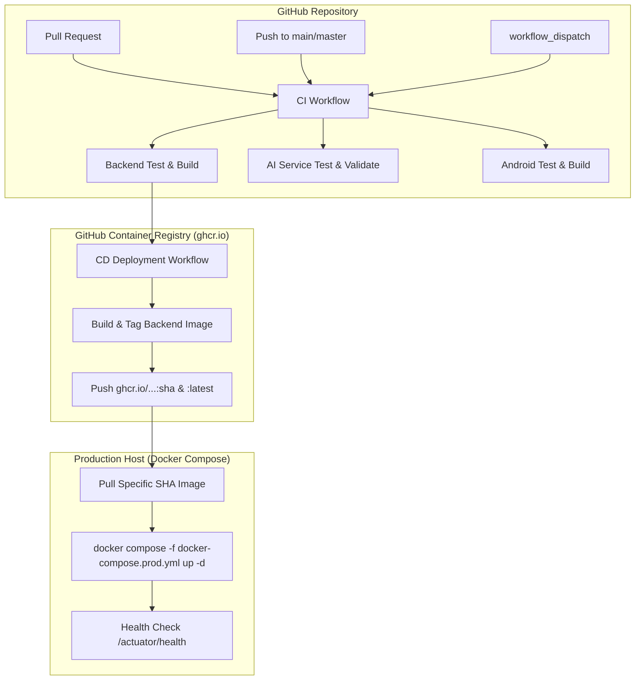

# Calisthenics AI - CI/CD & Production Deployment Guide

This document details the automated Continuous Integration (CI) and Continuous Deployment (CD) workflows for the **Calisthenics AI** ecosystem using GitHub Actions, Docker, and GitHub Container Registry (`ghcr.io`).

---

## 1. Architecture Overview



---

## 2. CI/CD Workflows

### A. Continuous Integration (`.github/workflows/ci.yml`)
- **Trigger**: Every push or pull request to `main` and `master`, or manual trigger.
- **Jobs**:
  1. **`backend-ci`**:
     - Sets up **JDK 21 (Temurin)** with Maven dependency caching.
     - Runs backend unit and integration tests (`mvn clean test`).
     - Packages the Spring Boot runnable JAR (`mvn package -DskipTests`).
     - Uploads the generated JAR artifact (`calisthenics-backend-jar`) with 7-day retention.
  2. **`ai-service-ci`**:
     - Sets up **Python 3.13** and installs `uv` with cache enabled.
     - Installs dependencies from frozen `uv.lock`.
     - Runs the complete PyTest test suite (`uv run pytest -v`).
     - Validates FastAPI application import and routes initialization.
  3. **`android-ci`**:
     - Sets up **JDK 21** with Gradle build cache action.
     - Runs unit tests (`./gradlew testDebugUnitTest`).
     - Assembles debug APK (`./gradlew assembleDebug`).
     - Archives the APK artifact (`calisthenics-ai-debug-apk`).

### B. Production Deployment (`.github/workflows/deploy.yml`)
- **Trigger**:
  - Automatically upon successful completion of the CI workflow on `main` / `master`.
  - Manually via `workflow_dispatch` (with environment selection).
- **Concurrency**: Grouped under `production-deployment` with `cancel-in-progress: false` to prevent overlapping or racing deployments.
- **Container Registry**: Packages and publishes images to `ghcr.io` tagged with:
  - Exact Git Commit SHA (`ghcr.io/xxdduu/calisthenics-ai-backend:<full-sha>`)
  - Short SHA (`ghcr.io/xxdduu/calisthenics-ai-backend:<7-char-sha>`)
  - `latest` (only on default branch)
- **Deployment Execution**:
  - If target SSH credentials are provided (`DEPLOY_HOST`, `DEPLOY_SSH_KEY`), it connects via SSH, pulls the exact `<sha>` tag, applies migrations, and brings up services using `docker-compose.prod.yml`.
  - If SSH credentials are not yet configured, the image remains securely stored in `ghcr.io` ready to be pulled by any server.

---

## 3. Required GitHub Secrets & Variables

### GitHub Actions Secrets
Configure these in **GitHub Repository** > **Settings** > **Secrets and variables** > **Actions**:

| Secret Name | Required | Purpose |
|---|---|---|
| `GITHUB_TOKEN` | Built-in | Used automatically to authenticate with `ghcr.io` for image pushes. |
| `PROD_DB_PASSWORD` | **Yes (Prod)** | Production PostgreSQL database password. |
| `PROD_JWT_SECRET` | **Yes (Prod)** | Cryptographically secure 256-bit secret for signing JWTs. |
| `DEPLOY_HOST` | Optional | IP address or domain name of the production server. |
| `DEPLOY_USER` | Optional | SSH username on the production server (default: `deploy`). |
| `DEPLOY_SSH_KEY` | Optional | Private SSH key authorized on the production server. |
| `DEPLOY_PORT` | Optional | SSH port (default: `22`). |
| `ANDROID_KEYSTORE_BASE64` | Optional | Base64-encoded release keystore for signing Android release APKs. |
| `KEYSTORE_PASSWORD` | Optional | Android keystore password. |
| `KEY_ALIAS` | Optional | Android signing key alias. |
| `KEY_PASSWORD` | Optional | Android signing key password. |

### GitHub Actions Variables
Configure these in **GitHub Repository** > **Settings** > **Secrets and variables** > **Variables**:

| Variable Name | Default | Purpose |
|---|---|---|
| `PRODUCTION_URL` | `http://localhost:8080` | Public URL of the deployed application. |
| `HOST_PORT` | `8080` | Port exposed on the host machine. |

---

## 4. Production Environment Configuration

1. On your production server, create the deployment directory:
   ```bash
   sudo mkdir -p /opt/calisthenics-ai
   sudo chown -R $USER:$USER /opt/calisthenics-ai
   cd /opt/calisthenics-ai
   ```

2. Copy [`docker-compose.prod.yml`](file:///home/duy/dev/calisthenics-ai/calisthenics-ai-backend/docker-compose.prod.yml) and [`.env.prod.example`](file:///home/duy/dev/calisthenics-ai/calisthenics-ai-backend/.env.prod.example):
   ```bash
   cp .env.prod.example .env.prod
   nano .env.prod
   ```

3. Populate the required production values:
   - `DB_PASSWORD`: Strong password for PostgreSQL.
   - `JWT_SECRET`: Random 256-bit secret (`openssl rand -hex 32`).
   - `BACKEND_IMAGE`: Set to the specific release image tag or leave `latest`.
   - `MAIL_USERNAME` and `MAIL_APP_PASSWORD`: SMTP credentials for OTP password resets.

---

## 5. Deployment Procedures

### Automated Deployment
Push your changes to `main` (or merge a Pull Request):
1. The `backend-ci` workflow tests and packages the application.
2. Upon passing, `deploy.yml` builds and pushes `ghcr.io/xxdduu/calisthenics-ai-backend:<commit-sha>`.
3. If SSH secrets are present, the server updates containers automatically.

### Manual Deployment via GitHub UI
1. Navigate to **Actions** > **Calisthenics AI - Production Deployment**.
2. Click **Run workflow**.
3. Select the branch (e.g. `main`) and target environment (`production`).
4. Click **Run workflow**.

### Manual Deployment on Server
```bash
cd /opt/calisthenics-ai

# Log in to GitHub Container Registry
echo "$GITHUB_TOKEN" | docker login ghcr.io -u <username> --password-stdin

# Pull new image
docker pull ghcr.io/xxdduu/calisthenics-ai-backend:<commit-sha>

# Deploy using production compose
BACKEND_IMAGE=ghcr.io/xxdduu/calisthenics-ai-backend:<commit-sha> \
docker compose --env-file .env.prod -f docker-compose.prod.yml up -d --remove-orphans
```

---

## 6. Monitoring & Health Checks

- **Backend Health Check**:
  ```bash
  curl -f http://localhost:8080/actuator/health
  # Expected: {"status":"UP",...}
  ```
- **AI Service Health Check**:
  ```bash
  curl -f http://localhost:8000/health
  # Expected: {"status":"healthy",...}
  ```
- **Container Status**:
  ```bash
  docker compose -f docker-compose.prod.yml ps
  ```
- **Live Logs**:
  ```bash
  docker compose -f docker-compose.prod.yml logs -f --tail=100 backend
  docker compose -f docker-compose.prod.yml logs -f --tail=100 ai-service
  ```

---

## 7. Rollback Strategy

Because all images are published with immutable **Git Commit SHA** tags, rolling back to any previous release is instant and deterministic:

1. Identify the previous working commit SHA (e.g. `60f4b8a...`).
2. Run on the production server:
   ```bash
   cd /opt/calisthenics-ai
   export BACKEND_IMAGE=ghcr.io/xxdduu/calisthenics-ai-backend:60f4b8a7e1c5fa27babfa71b8ee27de7e8cdb110
   docker compose --env-file .env.prod -f docker-compose.prod.yml up -d --remove-orphans
   ```
3. Verify system health:
   ```bash
   curl -f http://localhost:8080/actuator/health
   ```

---

## 8. Troubleshooting Common Issues

### Issue: Database connection refused during startup
- **Cause**: Backend started before PostgreSQL finished initialization.
- **Solution**: The `docker-compose.prod.yml` enforces `depends_on: postgres: condition: service_healthy` with a `pg_isready` health check. Ensure `DB_PASSWORD` in `.env.prod` matches `POSTGRES_PASSWORD`.

### Issue: Flyway Migration Failure
- **Cause**: Schema validation mismatch.
- **Solution**: Check backend logs (`docker compose -f docker-compose.prod.yml logs backend`). Inspect the failed migration script under `src/main/resources/db/migration/`. Flyway logs exact error locations without modifying previously executed migrations.

### Issue: Permission Denied on `uploads/`
- **Cause**: Container runs as non-root user or volume permissions mismatch.
- **Solution**: Ensure `/app/uploads` is owned by `appuser` (UID 1000) or mounted with proper write access.

